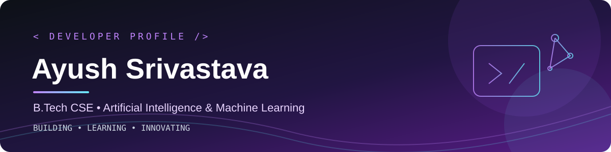

<div align="center">
  

  <br/>

  <a href="https://readme-typing-svg.demolab.com">
    
  </a>
</div>
<br>
<div align="center">
  
</div>


---

## 👨‍💻 About Me

Hi! I'm **Ayush Srivastava**, a Computer Science undergraduate specializing in Artificial Intelligence and Machine Learning, pursuing my B.Tech from **2023–2027**.

I enjoy developing practical software, exploring AI/ML techniques, and building applications that solve real-world problems.

- 🎓 **Education:** B.Tech CSE (AI & ML), 2023–2027
- 🤖 **Interests:** Artificial Intelligence, Machine Learning, and cybersecurity
- 🌐 **Development:** Frontend, backend, and full-stack web applications
- 🌱 **Currently learning:** Advanced AI/ML workflows and scalable application architecture
- 🛠️ **Enjoy building:** Research-oriented projects, web applications, and interactive dashboards
- 🤝 **Open to:** Internships, collaborations, hackathons, and open-source contributions

  <br>

```yaml
┌─────────────────────────────────────────┐
│     Ayush Srivastava  •  DEV            │
├─────────────────────────────────────────┤
│  Role    : Frontend Developer           │
│  Focus   : Web Apps & UI/UX             │
│  Status  : Open to Opportunities 🟢    |
│  Passion : Code · Design · Ship         │
└─────────────────────────────────────────┘
```
</br>

  
## 💼 Experience

### 🚀 Full Stack Engineer Intern
**TRENDTIDE CONNECT PRIVATE LIMITED** · Internship  
📅 June 2026 – Present  
📍 Surat, Gujarat, India · On-site

- Working on full-stack development and modern web technologies.
- Contributing to frontend and backend application development.
- Developing responsive web interfaces and integrating application functionality.
- Applying software development practices to build and improve web applications.

**Skills:** Full-Stack Development · Web Technologies

---

### 💻 Intern — IBM
**IBM** · Internship  
📅 6-Week 

- Architected and deployed a full-stack proof-of-concept application .
- Integrated responsive web interfaces and core mobile functionalities to meet a predefined business objective.
- Achieved **100% completion** of the final project deliverable.
- Demonstrated proficiency in full-stack development concepts and translating business requirements into a technical solution.

**Skills:** Full-Stack Development · Web Development · Responsive Design · Application Development

---
## ⚡ Tech Stack

### 💻 Programming Languages

<p>
  
  
  
  
  
  
  
</p>

### 🌐 Web Development

<p>
  
  
  
  
  
  
  
</p>

### 🤖 AI, Machine Learning & Data Science

<p>
  
  
  
  
  
  
</p>

### 🗄️ Databases & ORM

<p>
  
  
  
</p>

### ⚙️ Tools & Cloud

<p>
  
  
  
  
  
  
  
  
</p>

---

## 🚀 Featured Projects

### 🛡️ AI-Based Zero-Day Attack Detection

An AI/ML-based cybersecurity research project exploring network anomaly detection and potential unseen attacks.

- **Focus:** Network intrusion detection, anomaly detection, and hybrid machine learning
- **Datasets:** NSL-KDD and CICIDS2017
- **Technologies:** Python, scikit-learn, TensorFlow/PyTorch

### 🌱 Carbon Footprint Optimizer

A sustainability platform designed to estimate emissions, analyse resource usage, and provide recommendations to reduce energy consumption.

- **Focus:** Carbon accounting, AI workload tracking, optimization, and reporting
- **Technologies:** React, TypeScript, Vite, Tailwind CSS

### 📣 Trendtide Connect

An influencer marketing platform concept connecting brands with creators and helping plan campaigns.

- **Focus:** Creator discovery, campaign planning, and budget estimation
- **Technologies:** Modern web development tools

### 🧼 Home Rituals

An e-commerce website focused on home-cleaning essentials and a user-friendly shopping experience.

- **Focus:** Product presentation, shopping flows, backend integration, and payments
- **Technologies:** Web development, backend, and database tools

---

## 📊 GitHub Statistics

<div align="center">
  

  
</div>

<div align="center">
  
</div>

---


## 📈 Contribution Activity

<div align="center">

  <h3>My GitHub Contribution Calendar</h3>

  
  </a>
<br>
<h2 align="center">🌟 &nbsp;Thought of the Day 🌟</h2>

<div align="center">
  
</div>


---

## 🤝 Connect With Me

<div align="center">

<a href="https://github.com/srivastavaayush084">
  
</a>
<a href="https://www.linkedin.com/in/ayush-21-srivastava/">
  
</a>
<a href="mailto:srivastavaayush084@gmail.com">
  
</a>

</div>

---

<div align="center">

**“Great things are built one commit at a time.”**

<sub>Thanks for visiting my profile! ⭐ Feel free to explore my repositories and connect.</sub>

</div>
